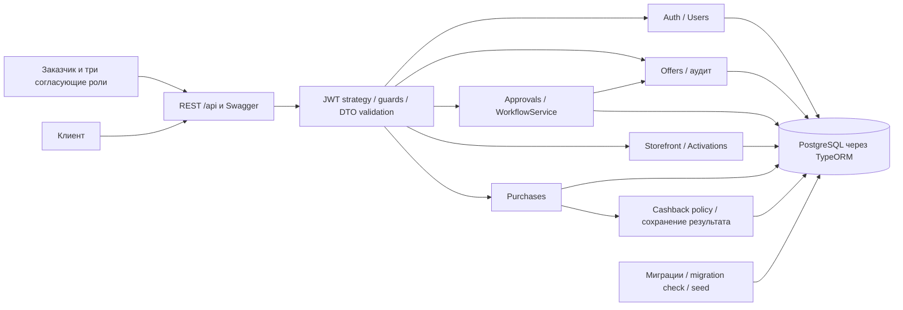
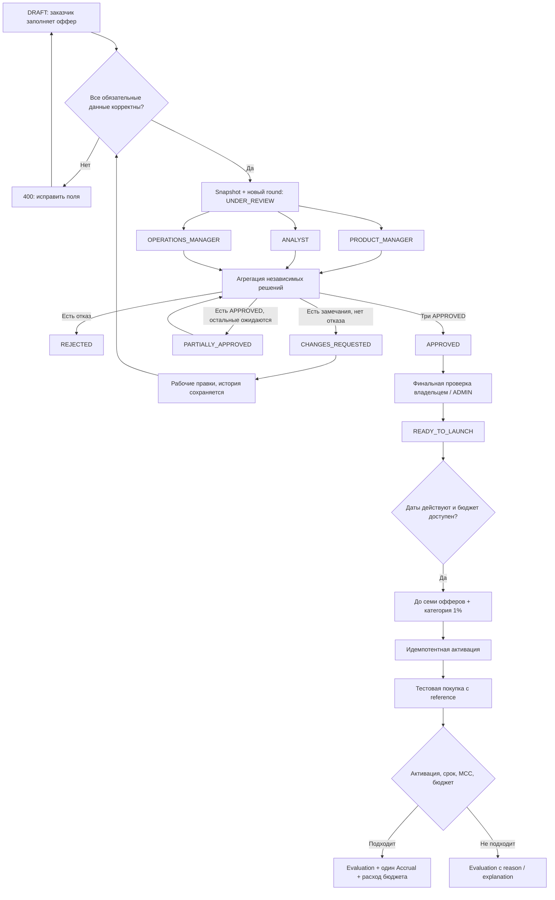

# Архитектура backend MVP

## Реализованная область

MVP построен поверх исходного NestJS 11 фундамента. ConfigModule, forRootAsync,
общие databaseOptions для CLI/runtime, Docker, health, ValidationPipe и Swagger сохранены.
synchronize=false и migrationsRun=false; реальная схема создаётся миграциями.
Auth, офферы, согласования, витрина, активации, покупки и кэшбэк реализованы.

## Требования и границы

Банк должен управлять полным циклом повышенного кэшбэка: заказчик создаёт оффер,
три направления независимо согласуют одни условия, исправления проходят новый раунд,
клиент видит только доступные согласованные предложения, активирует их и получает
однократное начисление за подходящую покупку в пределах общего бюджета.
Система должна объяснять блокировку запуска и отказ начисления, сохранять историю,
проверять роли и владение и выдерживать конкурирующие запросы.

Это самостоятельный backend. Swagger служит интерфейсом проверки API; отдельного
клиентского UI, внешнего банка, очередей и ML в проекте нет.
Проверяемые user stories и демонстрация описаны в [demo.md](demo.md),
доказательства по сценариям — в [testing.md](testing.md).

## Схема компонентов

ConfigModule предоставляет проверенное окружение runtime и CLI. Проверка здоровья
доступна отдельно: liveness проверяет процесс, readiness выполняет SELECT 1.

## Почему выбраны эти решения

| Решение                                     | Причина                                                                                | Компромисс                                                                        |
| ------------------------------------------- | -------------------------------------------------------------------------------------- | --------------------------------------------------------------------------------- |
| Модульный монолит NestJS                    | Один deploy и одна транзакционная БД; достаточно для кейса и быстрой проверки          | Модули масштабируются вместе; независимые сервисы не нужны для MVP                |
| PostgreSQL + TypeORM migrations             | FK, unique/check constraints, row locks и воспроизводимая схема                        | Изменения схемы нужно применять явно до запуска                                   |
| Три Review, а не цепочка и не boolean-поля  | Роли действительно рассматривают один снимок независимо; доступны авторы и комментарии | Статус нужно агрегировать централизованно                                         |
| Неизменяемый jsonb snapshot + ApprovalRound | Старые решения всегда относятся к конкретным условиям                                  | Часть данных дублируется; сложная аналитика по JSON не является задачей MVP       |
| FOR UPDATE строки Offer                     | Исключает потерю статуса и перерасход бюджета в конкурирующих транзакциях              | Записи одного оффера сериализуются; разные офферы не блокируют друг друга         |
| Advisory lock + unique constraints покупки  | Идемпотентность работает и при одновременном первом запросе                            | Привязка persistence-операции к PostgreSQL                                        |
| JWT access + хешируемая refresh-сессия      | Короткий access, ротация и отзыв; секрет refresh не хранится открыто                   | Access проверяет БД для немедленного logout, поэтому схема не полностью stateless |
| Decimal и numeric                           | Точный финансовый результат и проверяемый лимит                                        | Денежные строки в API требуют внимания frontend                                   |
| Детерминированная витрина без ML            | Исходные данные не содержат предпочтений клиентов                                      | Набор одинаков при одинаковой доступности; это не ML-персонализация               |
| Стандартный node:test и V8 coverage         | Нет отдельного тестового фреймворка; проверяются реальные бизнес-сценарии              | Численная метрика относится к исполняемому JS, не ко всему TS-приложению          |

## Схема бизнес-потока

Схема описывает существующие состояния: отдельного статуса LAUNCHED нет.
Бизнес-согласование параллельное, хотя атомарная запись результата одного оффера
защищена короткой блокировкой БД. Повторная покупка возвращает прежний результат.

## Сущности и связи

| Сущность           | Содержимое                                                                                |
| ------------------ | ----------------------------------------------------------------------------------------- |
| User               | UUID, нормализованный email, passwordHash (Argon2id, select:false), одна role, timestamps |
| RefreshSession     | Пользователь, SHA-256 хеш refresh JWT (select:false), expiresAt, revokedAt                |
| Offer              | Владелец, редактируемые бизнес-поля, статус, roundNumber, version, payoutSpent            |
| OfferRevision      | Оффер, номер, автор, неизменяемый jsonb snapshot бизнес-полей                             |
| ApprovalRound      | Оффер, снимок, номер, createdAt (открытие), closedAt                                      |
| Review             | Раунд, reviewerId, сохранённая reviewerRole, решение, комментарий, время                  |
| OfferEvent         | Оффер, actorId, тип, данные изменения до/после, время                                     |
| OfferActivation    | Клиент, оффер, createdAt (активация)                                                      |
| Purchase           | Клиент, один выбранный оффер, reference, amount, MCC, purchasedAt                         |
| CashbackEvaluation | Покупка, оффер, использованный снимок, результат, reason/explanation, сумма               |
| CashbackAccrual    | Успешная evaluation, покупка, сумма и время                                               |

У всех таблиц UUID PK и timestamps. FK используют RESTRICT, история не удаляется каскадно.
Деньги — numeric(18,2), проценты — numeric(5,2), API представляет их decimal-строками.
Дата/время — timestamptz UTC, MCC — четырёхзначные строки (включая ведущие нули), категория — строка.

Связи:

- User 1:N Offer, RefreshSession, OfferActivation, Purchase.
- Offer 1:N OfferRevision, ApprovalRound, OfferEvent, OfferActivation, Purchase, CashbackEvaluation.
- ApprovalRound N:1 OfferRevision; ApprovalRound 1:N Review; Review N:1 User.
- OfferActivation связывает клиента с оффером.
- Purchase имеет не более одной CashbackEvaluation и одного CashbackAccrual.
- CashbackAccrual относится к одной успешной evaluation; у evaluation не более одного accrual.

Ограничения:

- UNIQUE(email), UNIQUE(offerId, number) для ревизий и раундов.
- UNIQUE(roundId, reviewerRole), UNIQUE(revisionId) в раундах.
- Частичный UNIQUE(offerId) WHERE closedAt IS NULL.
- UNIQUE(clientId, offerId) у активаций.
- UNIQUE(clientId, reference) у покупок.
- UNIQUE(purchaseId) у evaluation и accrual, UNIQUE(evaluationId) у accrual.
- CHECK для денежных диапазонов, процентов, дат, MCC покупки, reviewerRole и непустого комментария.
- CHECK согласованности evaluation: начисление имеет положительную сумму без отказа;
  отказ — нулевую сумму с reason/explanation.
- DB triggers запрещают UPDATE/DELETE снимков, событий, решений, покупок, evaluations и accruals.

Изменяемый Offer не содержит boolean-полей согласования. Публикуемые условия соответствуют
последнему одобренному снимку; после APPROVED редактирование запрещено.

## Модули

| Модуль            | Ответственность                                                               |
| ----------------- | ----------------------------------------------------------------------------- |
| UsersModule       | Публичные профили, поиск для login, список ADMIN                              |
| AuthModule        | Argon2id, JWT access/refresh, rotation, session revocation, access strategy   |
| OffersModule      | Черновики и правки, политика данных, владение, аудит                          |
| ApprovalsModule   | WorkflowService, снимки/раунды/решения, агрегация состояния, запросы карточки |
| StorefrontModule  | Детерминированный выбор семи доступных офферов                                |
| ActivationsModule | Идемпотентная активация и список клиента                                      |
| PurchasesModule   | Приём покупки, идемпотентность и оркестрация транзакции                       |
| CashbackModule    | Чистая политика расчёта и сохранение результата/начисления                    |
| DatabaseModule    | TypeORM forRootAsync                                                          |
| HealthModule      | Liveness и readiness                                                          |

Контроллеры только связывают HTTP, DTO и сервисы. Общие guards: JwtAuthGuard и RolesGuard,
декораторы: CurrentUser, Public, Roles. По умолчанию все API защищены; публичны login/refresh/logout
(с проверкой refresh JWT), health и Swagger.

OfferAccessService централизует поиск, владение и блокировку. OfferAuditService пишет события.
Offer policy и cashback policy — чистые функции для правил и тестов, без HTTP-контроллеров.
Используется штатный EntityManager TypeORM в транзакциях; пустые repositories-обёртки не добавлены.

## Auth и безопасность

JWT проверяются по подписи HS256, сроку, issuer, audience и kind. Access и refresh имеют разные секреты
и audience. В JWT нет passwordHash. Access содержит sub/sid и проверяется по действующей сессии и
актуальному пользователю в БД. Logout отзывает сессию, поэтому её access tokens также перестают работать.

Refresh JWT содержит случайный jti; в БД только SHA-256 хеш высокоэнтропийного токена.
Refresh выполняет FOR UPDATE сессии и проверку хеша, выдаёт новую пару и заменяет хеш.
Старый refresh перестаёт работать; конкурентная ротация имеет одного победителя.
Повтор старого токена отклоняется, но не отзывает победившую сессию (допущение MVP).
Срок refresh скользящий, продлевается при ротации.

Пароли хешируются Argon2id; фиктивная проверка для неизвестного email уменьшает разницу времени login.
DTO запрещают посторонние поля и null вместо необязательного значения. Роли, владелец и статус
не принимаются из клиентского тела. Хеши select:false и не входят в response DTO.
Неожиданные ошибки дают общий 500 без raw SQL/credentials; сырые ошибки, JWT и пароли не логируются.
CORS ограничен конфигурируемым origin фронтенда.

ADMIN видит все профили/офферы/покупки, может создавать оффер от своего имени,
редактировать разрешённые офферы и выполнять ready-to-launch после согласования.
ADMIN не голосует вместо трёх ролей и не редактирует запущенные офферы.
Обычный OFFER_OWNER видит и меняет только свои офферы; согласующие видят внутренний каталог.
CLIENT видит витрину, свои активации и покупки.

## State machine

Все переходы выполняет WorkflowService; поля проверяет offer.policy.

| Состояние / событие                                           | Результат                           |
| ------------------------------------------------------------- | ----------------------------------- |
| DRAFT + валидный submit                                       | UNDER_REVIEW, новая ревизия и раунд |
| Открытый раунд, часть APPROVED, остальные отсутствуют         | PARTIALLY_APPROVED                  |
| Открытый раунд, хотя бы один CHANGES_REQUESTED и нет REJECTED | CHANGES_REQUESTED                   |
| Открытый раунд, хотя бы один REJECTED                         | REJECTED, раунд закрывается         |
| Все три обязательные роли APPROVED                            | APPROVED, раунд закрывается         |
| CHANGES_REQUESTED + исправления и submit                      | UNDER_REVIEW нового раунда          |
| APPROVED + финальная проверка владельца/ADMIN                 | READY_TO_LAUNCH                     |

Приоритет: REJECTED → CHANGES_REQUESTED → три APPROVED → PARTIALLY_APPROVED → UNDER_REVIEW.
Это сохранённое допущение из первоначального плана, а не заданный кейсом приоритет.
REJECTED в MVP терминальный: можно создать новый оффер, но не переписать отклонённую историю.

Редактируются DRAFT и CHANGES_REQUESTED. Неполный черновик допустим.
При передаче значения DTO и сервис проверяют тип/корректность; submit дополнительно требует
название, категорию, тип, описание, процент >0 и <=100, положительный лимит, непустые MCC,
начало и окончание с endsAt > startsAt. Запуск требует трёх одобрений текущего раунда
и endsAt > now. Будущее начало допускается до запуска, но оффер появится в витрине только после начала.

## Раунды, история и конкурентность

Submit в транзакции блокирует Offer (FOR UPDATE), проверяет состояние и поля,
закрывает предыдущий открытый раунд, увеличивает roundNumber, сохраняет snapshot,
открывает новый раунд и пишет SUBMITTED с предыдущим/новым статусом.
Уже сохранённое closedAt завершённого раунда не перезаписывается.
Каждый новый раунд требует новых решений всех трёх направлений.

Роли PRODUCT_MANAGER, ANALYST, OPERATIONS_MANAGER работают независимо и параллельно.
После запроса изменений оставшиеся роли могут закончить рассмотрение старого снимка,
пока раунд открыт. Рабочие правки не меняют snapshot.
После трёх решений раунд закрывается, даже если результат — CHANGES_REQUESTED.
Новая отправка закрывает старый открытый раунд, поздние решения отклоняются.

Review блокирует ту же строку Offer, проверяет текущий раунд и уникальность роли,
сохраняет решение, пересчитывает статус и записывает события атомарно.
Это сериализует конкурирующие изменения состояния, сохраняя параллельный бизнес-процесс.
Уникальный индекс дополнительно предотвращает повторное решение.
Редактирование также блокирует Offer; обновляет только явно разрешённые поля.
Version — счётчик изменений; отдельный клиентский optimistic-lock протокол в MVP не вводится.

CREATED и EDITED сохраняют бизнес-данные, SUBMITTED — round/revision,
REVIEWED — пользователя, роль, решение, комментарий и переход.
CHANGES_REQUESTED отдельно отмечает возврат, READY_TO_LAUNCH — готовность.
Снимки, решения и события защищены от изменения/удаления не только отсутствием endpoints,
но и триггерами БД.

Карточка возвращает status, currentRound со snapshot/reviews, pendingRoles и launchBlockers.
История раундов загружает решения одним пакетным запросом, без N+1.

## Витрина и активации

Выбираются READY_TO_LAUNCH с startsAt <= now < endsAt и payoutSpent < payoutLimit.
Приоритет: PARTNER, затем ближайший endsAt, затем UUID; максимум семь.
При отсутствии клиентских предпочтений алгоритм одинаков для клиентов — осознанная простая
эвристика без искусственной персонализации и ML. Если кандидатов меньше семи, возвращаются имеющиеся.
Обязательная baseCategory «1% на всё» всегда отдельна от этих семи.

Первая активация разрешена только для текущей витрины клиента.
Операция блокирует Offer, проверяет уже существующую активацию, затем доступность и вставляет запись.
Повтор возвращает прежнюю запись даже после истечения срока оффера.
Unique constraint обеспечивает идемпотентность и на уровне БД.
Список активаций сохраняет видимость ранее активированных, в том числе истёкших офферов.

## Покупки и кэшбэк

Минимальное допущение: тестовая покупка явно выбирает один offerId. Это исключает
неопределённый кейсом выбор между пересекающимися офферами и двойное начисление по разным программам.
Клиент определяется токеном; клиент не может зарегистрировать покупку за другого клиента.
reference уникален в пределах клиента. purchasedAt не может быть в будущем; исторические покупки разрешены.

Транзакция сначала берёт advisory_xact_lock по clientId/reference, находит повтор и сверяет payload,
затем блокирует Offer. Покупка, evaluation, accrual и payoutSpent сохраняются вместе.
Повтор возвращает неизменяемый исходный результат, изменённый payload даёт 409.
Уникальные ограничения purchase/evaluation/accrual — дополнительная защита.

Порядок проверки:

1. Активация существует и не позже purchasedAt.
2. Оффер READY_TO_LAUNCH и есть snapshot.
3. startsAt <= purchasedAt < endsAt.
4. MCC входит в snapshot.mccCodes.
5. Сумма amount * cashbackPercent / 100 округляется HALF_UP до двух знаков.
6. Нулевое округление отклоняется; полный кэшбэк должен помещаться в остаток бюджета.

Все расчёты decimal; payoutLimit — общий денежный бюджет оффера.
Частичных выплат нет. Двухзначная денежная точность без мультивалютности — допущение MVP.
Под блокировкой проверяется и расходуется бюджет, поэтому два конкурентных запроса
не могут израсходовать один остаток. Бизнес-отказы не превращаются в технические исключения:
evaluation сохраняет machine-readable reason и понятное explanation.

Базовый «1% на всё» представлен в витрине. Его финансовая механика не задана кейсом,
поэтому расчёт базового банковского кэшбэка не выдумывается.

## REST API и проверки

Полный список доступных путей, команды и demo credentials — в README.md и Swagger.
Потенциально большие списки имеют page/limit, cap limit=100.
Review-list ограничен тремя, storefront — семью.
DTO Swagger отделены от entities; денежные значения описаны как строки.
HTTP 200 для идемпотентных покупок и активаций, 201 для новых офферов/раундов/решений,
204 для logout; стандартные 400/401/403/404/409 для ошибок.

Unit tests проверяют агрегацию статуса, поля/снимки, владение, decimal, даты, конфигурацию и JWT.
E2E работают с реальным PostgreSQL в собственной временной базе и настоящим HTTP:
включают миграции с rollback, два раунда, историю, запуск, витрину, идемпотентность,
конкурентный бюджет, роли, негативные условия, rotation/replay/logout и повтор seed.

Реальные банковские интеграции, платежи, мобильное приложение, ML и enterprise-инфраструктура
в MVP не входят.
